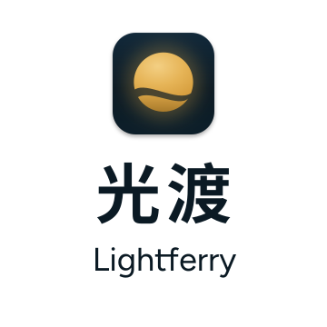
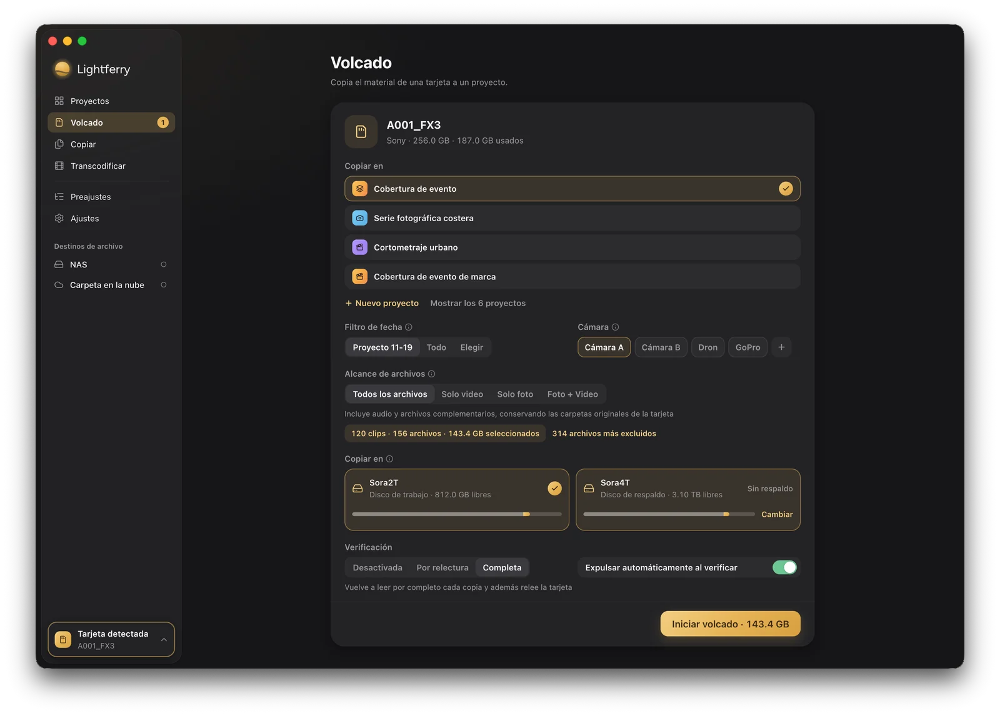
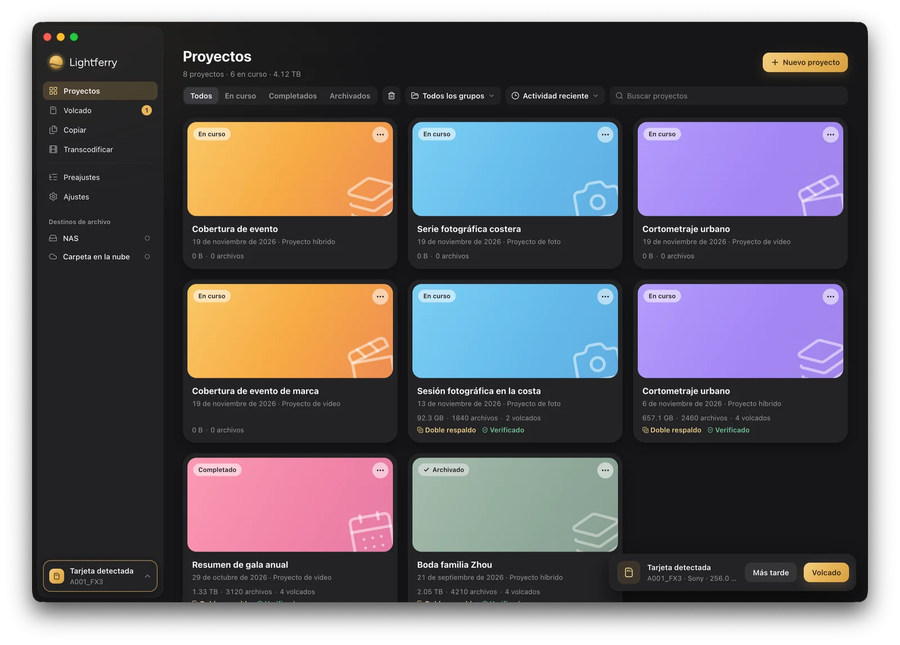
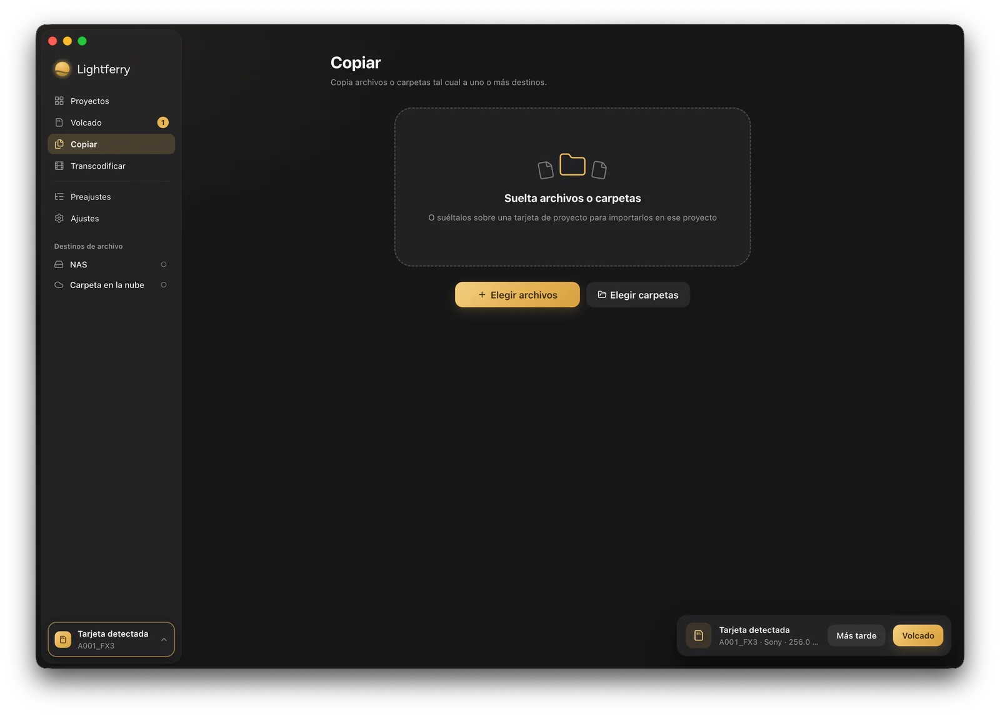

[简体中文](./README.md) · [繁體中文](./README.zh-TW.md) · [English](./README.en.md) · [日本語](./README.ja.md) · [한국어](./README.ko.md) · [Español](./README.es.md)

  <picture>
    <source media="(prefers-color-scheme: dark)" srcset="./brand/lockup-icon-white.svg">
    
  </picture>

<h3 align="center">Lleva cada momento a salvo a casa.</h3>

Un espacio de trabajo de material para Mac pensado para fotógrafos, DIT y equipos de producción audiovisual. Lee una tarjeta de cámara una sola vez, escribe a la vez en tu disco de trabajo y en tu disco de respaldo, verifica cada copia, organízala por proyecto y guarda un informe que podrás consultar después.

  
  
  

  <a href="https://github.com/Sorasukiawa/lightferry/releases/download/v1.0.0/Lightferry_1.0.0_aarch64.dmg"><strong>Descargar v1.0.0 · Mac con chip de Apple</strong></a>
  &nbsp;·&nbsp; <a href="https://lightferry.app/es/guides/">Guías de uso</a>
  &nbsp;·&nbsp; <a href="https://github.com/Sorasukiawa/lightferry/releases/tag/v1.0.0">Novedades</a>
  &nbsp;·&nbsp; <a href="https://lightferry.app/es/pricing/">Comprar</a>
  &nbsp;·&nbsp; <a href="./VERSIONS.md">Todas las versiones</a>

> [!NOTE]
> Los instaladores están firmados con Apple Developer ID y notarizados. Descárgalos desde [Releases de este repositorio](https://github.com/Sorasukiawa/lightferry/releases) o [lightferry.app](https://lightferry.app/es/download/).

Captura real de ventana en Mac: tras insertar una tarjeta, elige proyecto y cámara, escribe en dos discos a la vez y realiza una verificación completa. Los proyectos y carpetas de ejemplo son solo demostrativos.

## Copia. Verifica. Organiza.

<table>
  <tr>
    <td valign="top" width="50%">
      <picture><source media="(prefers-color-scheme: dark)" srcset="./brand/icons/offload-dawn.svg"></picture> 
      <strong>Volcado de tarjetas</strong> 
      Inserta una tarjeta y Lightferry detecta fotos, video y audio, clasificándolos por proyecto, fecha de rodaje y cámara. Lee el origen una sola vez mientras escribe en el disco de trabajo y en un segundo respaldo.
    </td>
    <td valign="top" width="50%">
      <picture><source media="(prefers-color-scheme: dark)" srcset="./brand/icons/copy-dawn.svg"></picture> 
      <strong>Copia de archivos y carpetas</strong> 
      Arrastra desde Finder o elige un origen, conserva la jerarquía de carpetas y escríbela tal cual en uno o más destinos, con comprobación previa de espacio antes de empezar.
    </td>
  </tr>
  <tr>
    <td valign="top">
      <picture><source media="(prefers-color-scheme: dark)" srcset="./brand/icons/projects-dawn.svg"></picture> 
      <strong>Enlace con proyectos de edición</strong> 
      Elige Final Cut Pro, DaVinci Resolve, Premiere Pro o CapCut al crear un proyecto y, tras un volcado verificado, Lightferry envía el material o genera el proyecto automáticamente.
    </td>
    <td valign="top">
      <picture><source media="(prefers-color-scheme: dark)" srcset="./brand/icons/video-dawn.svg"></picture> 
      <strong>Copias de revisión y proxies</strong> 
      Convierte clips en copias de revisión H.264 o proxies ProRes que se vuelven a vincular con los originales en tu editor. El material Log puede usar la LUT oficial del fabricante, descargada directamente y comprobada con SHA-256, para generar copias de revisión Rec.709.
    </td>
  </tr>
  <tr>
    <td valign="top">
      <picture><source media="(prefers-color-scheme: dark)" srcset="./brand/icons/organize-dawn.svg"></picture> 
      <strong>Importación de recursos al proyecto</strong> 
      Añade material existente a un proyecto concreto, colocando fotos, video, audio y archivos de edición en sus carpetas correspondientes.
    </td>
    <td valign="top">
      <picture><source media="(prefers-color-scheme: dark)" srcset="./brand/icons/archive-dawn.svg"></picture> 
      <strong>Archivo de proyectos</strong> 
      Archiva un proyecto en un destino local o de red con verificación completa obligatoria. Se conserva el registro del proyecto y nunca se elimina automáticamente el material local.
    </td>
  </tr>
  <tr>
    <td valign="top">
      <picture><source media="(prefers-color-scheme: dark)" srcset="./brand/icons/verify-dawn.svg"></picture> 
      <strong>Tres niveles de verificación</strong> 
      Elige desactivada, rápida o completa según la importancia del material. Cada destino recibe su propio resultado de verificación.
    </td>
    <td valign="top">
      <picture><source media="(prefers-color-scheme: dark)" srcset="./brand/icons/recovery-dawn.svg"></picture> 
      <strong>Recuperación y reintento</strong> 
      Tras una interrupción, un destino desconectado o un disco lleno, Lightferry vuelve a comprobar la identidad y el espacio del destino y reintenta solo las copias incompletas.
    </td>
  </tr>
  <tr>
    <td valign="top">
      <picture><source media="(prefers-color-scheme: dark)" srcset="./brand/icons/report-dawn.svg"></picture> 
      <strong>Informes y avisos por correo</strong> 
      Busca resultados por proyecto, fecha, tipo y estado, y expórtalos a HTML sin conexión, PDF de varias páginas y manifiesto ASC MHL. Un correo al terminar indica si la tarjeta se puede formatear, y las notificaciones abren el informe correspondiente.
    </td>
    <td valign="top">
      <picture><source media="(prefers-color-scheme: dark)" srcset="./brand/icons/presets-dawn.svg"></picture> 
      <strong>Preajustes de carpetas</strong> 
      Estructuras integradas para proyectos de video, foto e híbridos que puedes duplicar y personalizar. Cada proyecto nuevo genera automáticamente todo el árbol de carpetas.
    </td>
  </tr>
</table>

## Tres compromisos

- **Nunca se sobrescriben archivos existentes.** Cuando coinciden los nombres, decides tú si omitir o conservar ambos. Lightferry nunca reemplaza archivos en silencio.
- **Cada copia tiene su propio resultado.** Las tareas con varios destinos registran por separado la copia y la verificación de cada uno. Tras una interrupción o desconexión, vuelve a comprobarse la identidad y la capacidad del destino antes de completar lo pendiente.
- **Todo ocurre en tu Mac.** El escaneo, la copia, la verificación y los registros de proyectos se ejecutan en local por omisión; Lightferry no sube tus fotos ni videos a sus servidores.

## ¿Por qué no arrastrar simplemente en Finder?

| | Arrastrar en Finder | Lightferry |
| --- | --- | --- |
| Escribir en dos discos | Arrastras dos veces y lees la tarjeta dos veces | Lee una vez, escribe en ambos a la vez |
| Comprobación al terminar | No verifica el contenido | Verificación rápida o completa por copia |
| Desconexión o interrupción | Empezar de cero o comparar a mano | Reintenta solo los archivos incompletos |
| Nombres repetidos | Puede ofrecer reemplazar | Nunca sobrescribe archivos existentes |
| Carpetas | Crearlas manualmente | Clasificación automática por proyecto, fecha y cámara |
| Registro | Ninguno | Informes de tareas en HTML o PDF |

## De la tarjeta al archivo

1. **Volcado**: inserta una tarjeta de cámara o arrastra archivos y carpetas. Elige proyecto y cámara, y filtra por fecha de rodaje.
2. **Escritura**: el origen se lee una sola vez y se escribe a la vez en el disco de trabajo y en el disco de respaldo, tras comprobar espacio e identidad de destino.
3. **Verificación**: la verificación rápida relee cada copia y compara su XXH64. La verificación completa relee además el origen de forma independiente.
4. **Conservación**: los resultados se pueden buscar y exportar, y los proyectos se pueden archivar en destinos locales o de red manteniendo sus registros intactos.

## Un vistazo a la app

### Espacio de proyectos

Cada proyecto tiene una tarjeta con el tipo, la fecha de rodaje, el tamaño del material y el número de archivos. Tras un volcado, muestra también si cuenta con doble respaldo y si superó la verificación. Puedes filtrar por activos, completados, archivados y Papelera, o agrupar proyectos.

### Copiar

Copia archivos y carpetas tal cual a una o más ubicaciones manteniendo su jerarquía. Antes de iniciar muestra el espacio disponible y el necesario en cada destino, y al terminar verifica cada copia por separado.

### Informes de tareas

Al terminar un volcado, una copia de archivos, una importación de recursos o un archivo, puedes localizarlo en los informes por proyecto, fecha, tipo y estado, y exportarlo en HTML sin conexión o PDF multipágina. Los campos ausentes en registros antiguos se marcan como no registrados en lugar de darse por buenos.

Todas las capturas corresponden a ventanas reales en Mac; los proyectos, archivos y rutas son solo demostrativos.

## Niveles de verificación

- **Desactivada**: depende únicamente de si se producen errores de escritura. Adecuada para archivos temporales, no para material importante.
- **Rápida**: vuelve a leer cada archivo de destino y compara su XXH64 con el hash calculado del origen durante la copia. Ideal para volcados y copias cotidianos.
- **Completa**: suma a la verificación rápida una relectura independiente de todos los archivos de origen. Recomendada para material crítico, dobles respaldos y archivo.

XXH64 detecta diferencias de contenido, pero no es una firma criptográfica. Revisa también por muestreo el material crítico después de superar la verificación.

## Primeros pasos

1. Descarga arriba el DMG para **Mac con chip de Apple**. No hay instalador público para Mac con Intel ni para Windows. Puedes comprobar tu chip en **menú Apple → Acerca de este Mac**.
2. Abre el DMG y arrastra Lightferry a Aplicaciones. Al abrirlo por primera vez, macOS confirmará que es una app descargada de internet; elige Abrir.
3. Define tus discos de trabajo y respaldo en Ajustes, crea un proyecto e inserta una tarjeta. Para material importante conserva la tarjeta original y otro respaldo fiable; formatea la tarjeta solo tras comprobar las copias.

- **Chip**: chip de Apple (serie M)
- **Sistema**: macOS 13 o posterior
- **Almacenamiento**: se recomienda APFS para los discos de trabajo, respaldo y archivo. ExFAT puede usarse como destino si supera la comprobación de seguridad, y las tarjetas de cámara ExFAT funcionan como origen de solo lectura.

Las tareas activas de volcado, copia de archivos o archivo impiden instalar actualizaciones mientras se ejecutan.

## Precios

Lightferry es un pago único sin suscripción. La organización de proyectos y los preajustes de carpetas son gratis para siempre; prueba cada tipo de tarea 3 veces gratis y compra en [lightferry.app](https://lightferry.app/es/pricing/) o desde la app. Shiguang v0.2.2 y anteriores no caducan y siguen siendo gratuitos.

| Plan | Precio | Incluye |
| --- | --- | --- |
| Gratis | $0 | Proyectos, historial, informes y preajustes siempre disponibles; 3 usos gratuitos por cada tipo de tarea, como volcado y copia, o archivo, sin límite de tiempo |
| Licencia perpetua | $59 ($49 durante el periodo de lanzamiento) | 2 Mac a la vez, uso perpetuo, actualizaciones gratuitas para tu versión principal y cualquier nueva versión principal publicada en el plazo de un año |
| Actualización principal | $29 por actualización | Actualiza a una versión principal posterior todos los Mac del pedido; mismo precio sin importar cuántas versiones saltes; nunca se cobra automáticamente |
| Pase de 30 días | $10 / Mac | Se compra dentro de la app; no se renueva automáticamente |
| Puesto adicional para Mac | $19 / Mac | Añade más Mac a un pedido perpetuo (cada licencia incluye 2 Mac, hasta 4 en total) |

- Todos los productos de pago admiten reembolso íntegro en un plazo de 14 días desde la compra, sin preguntas.
- Los pagos se procesan en dólares estadounidenses mediante Creem.
- Los derechos adquiridos al comprar nunca se retiran por cambios posteriores en la política comercial.

## Preguntas frecuentes

<strong>¿Qué hago si macOS no puede abrir la app?</strong>

Lightferry está notarizado por Apple, así que normalmente solo tendrás que confirmar una vez al abrirlo por primera vez. Si macOS aún lo bloquea, comprueba que el instalador procede de Releases de este repositorio o de lightferry.app y revisa el aviso en **Ajustes del Sistema → Privacidad y seguridad**. [Ayuda de instalación](https://lightferry.app/es/download/#download-help)

<strong>Si desconecto un disco o falla una tarea, ¿tengo que empezar de cero?</strong>

No. Conserva la tarjeta original, las copias existentes y el historial de la tarea. Vuelve a conectar los dispositivos originales y abre la recuperación de la tarea. Lightferry comprueba los archivos ya completos y copia solo los pendientes; no elimines antes las copias existentes.

<strong>¿Puedo formatear la tarjeta si falló la verificación?</strong>

Todavía no. Revisa el resultado de cada destino, conserva la tarjeta y las copias válidas, y usa el registro de fallos para investigar y reintentar. Que la barra llegue al 100 % no significa que todas las copias hayan pasado la verificación. [Qué comprobar tras un volcado](https://lightferry.app/es/guides/first-ingest/)

<strong>¿Puedo volcar directamente a un NAS?</strong>

Vuelca primero a un disco local o externo y luego archiva en tu NAS desde los detalles del proyecto. [Guía de archivo en NAS](https://lightferry.app/es/guides/connect-nas/)

<strong>Si termina el archivo local, ¿significa que terminó la subida a la nube?</strong>

No. Lightferry solo confirma la copia y la verificación en local. Comprueba la subida por separado en tu app en la nube y en la web del servicio. [Guía de sincronización en la nube](https://lightferry.app/es/guides/cloud-sync/)

<strong>¿Qué debo saber al actualizar desde Shiguang?</strong>

Al actualizar de Shiguang 0.2.x a Lightferry 1.0 se pasa a licencia de pago, y cada tipo de tarea empieza con 3 pruebas gratuitas (las tareas anteriores no cuentan). Los proyectos, grupos, ajustes, preajustes y registros de copias interrumpidas se migran automáticamente, y la carpeta de datos antigua se conserva intacta (si reinstalas 0.2.2 podrás abrir la biblioteca anterior, pero los cambios hechos en 1.0 no se sincronizan de vuelta). Tras actualizar, la app en Aplicaciones conserva el nombre exterior «Shiguang»; puedes cambiarlo a «Lightferry» en Finder sin afectar a las futuras actualizaciones dentro de la app. La primera vez que Lightferry acceda a discos externos y de red, macOS volverá a pedir permiso; elige Permitir.

<strong>¿Es compatible con Intel o Windows? ¿Cuánto cuesta?</strong>

Actualmente solo es compatible con Mac con chip de Apple. Lightferry es un pago único: la organización de proyectos y los preajustes son gratis para siempre, cada tipo de tarea incluye 3 pruebas gratuitas y la licencia perpetua cuesta $59 ($49 durante el periodo de lanzamiento). Consulta [Precios](#precios).

## Versión actual · v1.0.0

- Shiguang ahora es Lightferry, con firma Apple Developer ID y notarización de Apple.
- Enlace con proyectos de edición: tras un volcado verificado, el material se envía a Final Cut Pro, DaVinci Resolve, Premiere Pro o CapCut, o se genera el proyecto automáticamente.
- Copias de revisión y proxies de edición: copias H.264 o proxies ProRes que se vuelven a vincular con los originales; el material Log puede usar la LUT oficial del fabricante para copias de revisión Rec.709.
- Verificación de tarjetas más estricta: relectura completa sin caché o verificación durante la copia, un veredicto claro al terminar sobre si se puede formatear y manifiestos ASC MHL.
- Avisos por correo al finalizar y portal web de licencias: recibe un correo que indica si la tarjeta se puede formatear y gestiona o recupera tus licencias en la web.

[Leer notas de versión completas](https://github.com/Sorasukiawa/lightferry/releases/tag/v1.0.0) · [Todas las versiones](./VERSIONS.md)

Discos de almacenamiento y carpetas de red

- Se recomienda APFS para los discos de trabajo, segundo respaldo y archivo. ExFAT solo se admite como destino si supera la comprobación de seguridad de Lightferry; de lo contrario, se rechaza antes de escribir. Las tarjetas de cámara ExFAT funcionan como origen de solo lectura. Lightferry nunca te pide formatear medios existentes.
- Si archivas en un NAS o en una carpeta sincronizada de terceros, Lightferry confirma únicamente la copia y la verificación locales. La transferencia de red o sincronización posterior depende del sistema operativo o del servicio correspondiente; verifica el comportamiento ante desconexiones y sincronización en tu propio entorno.

## Ayuda y comentarios

- **[Guías de uso](https://lightferry.app/es/guides/)**: pasos detallados para instalar, volcar, recuperar tareas interrumpidas y archivar.
- **[Informar de un error o sugerir una mejora](https://github.com/Sorasukiawa/lightferry/issues/new/choose)**: el formulario pide versión de la app, versión de macOS y chip, formato de origen y destino, pasos para reproducirlo y texto del error.
- **[Preguntas e ideas](https://github.com/Sorasukiawa/lightferry/discussions)**: dudas de uso, flujos de trabajo e ideas.
- **Consultas privadas**: escribe a [support@lightferry.app](mailto:support@lightferry.app). Para temas de seguridad, consulta [SECURITY.md](./SECURITY.md).

Oculta nombres de proyectos y rutas en las capturas de pantalla. **No subas material original ni información de clientes.**

## Acerca de este repositorio

> [!NOTE]
> Este repositorio publica instaladores, documentación, historial de versiones y canal de comentarios. **No contiene el código fuente de la app Lightferry ni concede licencia de código abierto o redistribución**; consulta [LICENSE.md](./LICENSE.md). Los archivos Source code generados automáticamente por GitHub contienen solo los materiales públicos de este repositorio y no sirven como instaladores de la app.
