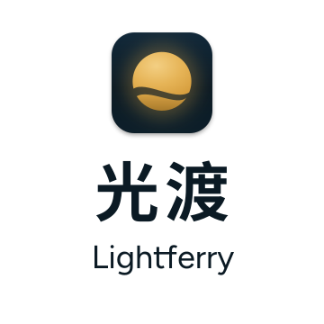
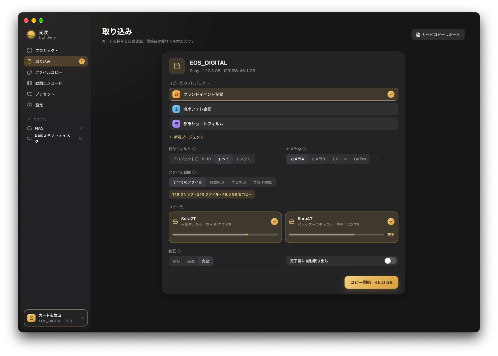
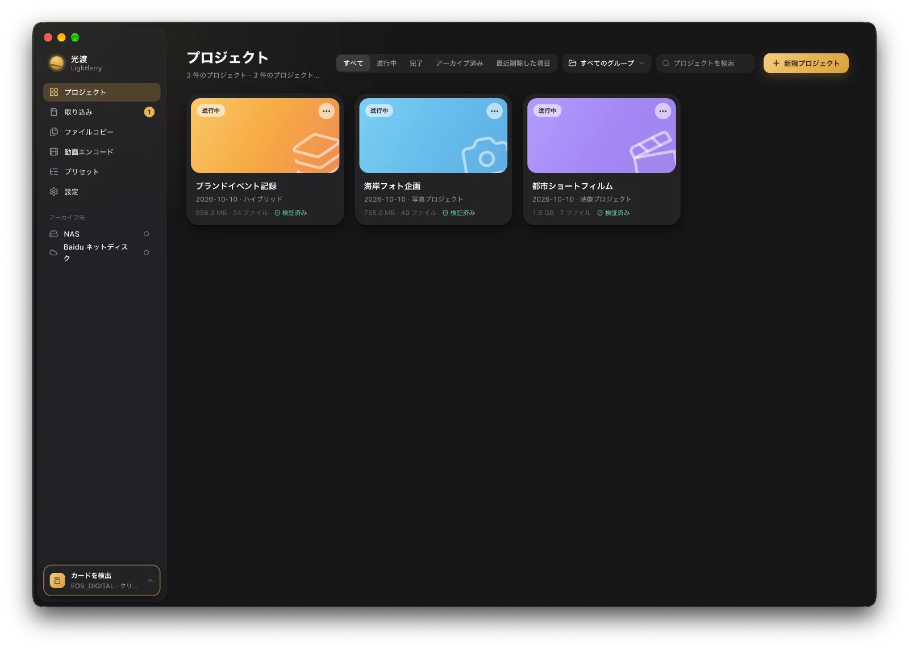
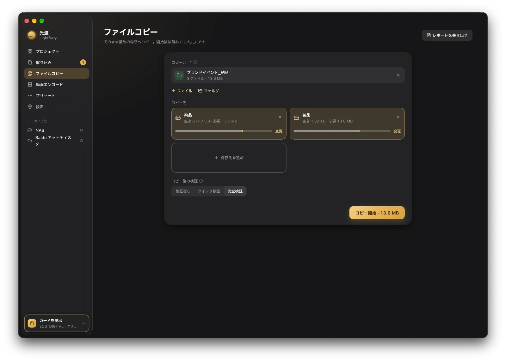

[简体中文](./README.md) · [繁體中文](./README.zh-TW.md) · [English](./README.en.md) · [日本語](./README.ja.md) · [한국어](./README.ko.md) · [Español](./README.es.md)

  <picture>
    <source media="(prefers-color-scheme: dark)" srcset="./brand/lockup-icon-white.svg">
    
  </picture>

<h3 align="center">撮りためた光を、次の場所へ。</h3>

写真家、DIT、映像制作チームのための Mac 用素材ワークスペース。 カメラカードを一度読み、作業用ディスクとバックアップへ同時に書き込み、コピーを一つずつ検証し、プロジェクトごとに整理して、後から確認できるレポートを残します。

  
  
  

  <a href="https://github.com/Sorasukiawa/lightferry/releases/download/v1.0.1/Lightferry_1.0.1_aarch64.dmg"><strong>v1.0.1 をダウンロード · Apple Silicon Mac</strong></a>
  &nbsp;·&nbsp; <a href="https://lightferry.app/ja/guides/">使い方</a>
  &nbsp;·&nbsp; <a href="https://github.com/Sorasukiawa/lightferry/releases/tag/v1.0.1">更新内容</a>
  &nbsp;·&nbsp; <a href="https://lightferry.app/ja/pricing/">購入</a>
  &nbsp;·&nbsp; <a href="./VERSIONS.md">すべてのバージョン</a>

> [!NOTE]
> インストーラーは Apple Developer ID で署名され、公証済みです。[このリポジトリの Releases](https://github.com/Sorasukiawa/lightferry/releases) または [lightferry.app](https://lightferry.app/ja/download/) から入手してください。

Mac 上の実際のウィンドウキャプチャ：カードを挿してプロジェクトとカメラを選び、2 台のドライブへ書き込んで完全に検証します。サンプルのプロジェクトとフォルダーはデモ用です。

## コピー・検証・整理

<table>
  <tr>
    <td valign="top" width="50%">
      <picture><source media="(prefers-color-scheme: dark)" srcset="./brand/icons/offload-dawn.svg"></picture> 
      <strong>カード取り込み</strong> 
      カードを挿すと写真・動画・音声を検出し、プロジェクト、撮影日、カメラごとに整理。元カードを一度読み、作業用と二つ目のバックアップ先へ同時に書き込みます。
    </td>
    <td valign="top" width="50%">
      <picture><source media="(prefers-color-scheme: dark)" srcset="./brand/icons/copy-dawn.svg"></picture> 
      <strong>ファイル／フォルダーのコピー</strong> 
      Finder からドラッグ、または選択。階層を保ったまま一つ以上の保存先へそのままコピーし、開始前に空き容量を確認します。
    </td>
  </tr>
  <tr>
    <td valign="top">
      <picture><source media="(prefers-color-scheme: dark)" srcset="./brand/icons/projects-dawn.svg"></picture> 
      <strong>編集プロジェクト連携</strong> 
      新規プロジェクトで Final Cut Pro・DaVinci Resolve・Premiere Pro・CapCut を選ぶと、取り込みの検証が通った後に素材を自動で送るか、プロジェクトを生成します。
    </td>
    <td valign="top">
      <picture><source media="(prefers-color-scheme: dark)" srcset="./brand/icons/video-dawn.svg"></picture> 
      <strong>レビュー用ファイルとプロキシ</strong> 
      動画を H.264 のレビュー用ファイルや ProRes の編集用プロキシに変換し、編集ソフトで元素材へ再リンクできます。Log 素材はメーカー公式 LUT を直接取得して SHA-256 を照合し、Rec.709 のレビュー用ファイルにできます。
    </td>
  </tr>
  <tr>
    <td valign="top">
      <picture><source media="(prefers-color-scheme: dark)" srcset="./brand/icons/organize-dawn.svg"></picture> 
      <strong>プロジェクトへの素材追加</strong> 
      既存の素材を指定プロジェクトへ追加し、写真・動画・音声・制作ファイルなどをプロジェクトのフォルダーへ振り分けます。
    </td>
    <td valign="top">
      <picture><source media="(prefers-color-scheme: dark)" srcset="./brand/icons/archive-dawn.svg"></picture> 
      <strong>プロジェクトのアーカイブ</strong> 
      ローカルまたはネットワーク先へアーカイブ。完全検証を必ず実行し、プロジェクト記録を保持したまま、ローカル素材を自動削除しません。
    </td>
  </tr>
  <tr>
    <td valign="top">
      <picture><source media="(prefers-color-scheme: dark)" srcset="./brand/icons/verify-dawn.svg"></picture> 
      <strong>3 段階の検証</strong> 
      なし・高速・完全を素材の重要度で選択。保存先ごとに検証結果を示します。
    </td>
    <td valign="top">
      <picture><source media="(prefers-color-scheme: dark)" srcset="./brand/icons/recovery-dawn.svg"></picture> 
      <strong>中断後の復旧と再試行</strong> 
      中断、保存先の切断、空き容量不足の後は、保存先の識別情報と空き容量を再確認し、未完了のコピーだけを再試行します。
    </td>
  </tr>
  <tr>
    <td valign="top">
      <picture><source media="(prefers-color-scheme: dark)" srcset="./brand/icons/report-dawn.svg"></picture> 
      <strong>作業レポートとメール通知</strong> 
      プロジェクト、日付、種類、状態で結果を探し、オフライン HTML、複数ページの PDF、ASC MHL に書き出し。完了メールでカードを初期化してよいかを知らせ、完了通知から該当レポートを開けます。
    </td>
    <td valign="top">
      <picture><source media="(prefers-color-scheme: dark)" srcset="./brand/icons/presets-dawn.svg"></picture> 
      <strong>フォルダープリセット</strong> 
      映像・写真・ハイブリッド用の内蔵構成を複製してカスタマイズ。新規プロジェクトにはフォルダー一式が自動で作られます。
    </td>
  </tr>
</table>

## 三つの約束

- **既存ファイルを上書きしません。** 同名のものがあればスキップか両方保持を選べます。黙って置き換えることはありません。
- **コピーごとに結果を残します。** 複数の保存先は別々にコピーと検証の状態を記録。中断や切断の後は保存先の識別情報と空き容量を再確認してから、未完了分だけを再試行します。
- **すべて Mac の中で完結します。** 素材の走査・コピー・検証とプロジェクト記録は既定でローカル処理され、光渡のサーバーへ写真や動画をアップロードしません。

## Finder でドラッグするのと何が違う？

| | Finder でドラッグ | 光渡 |
| --- | --- | --- |
| 2 台への書き込み | 2 回ドラッグ、カードも 2 回読む | 一度読んで同時に書き込み |
| コピー後の確認 | 内容は確認しない | 高速または完全検証、コピーごとに結果 |
| 抜けた・中断した | やり直すか手で比較 | 未完了のファイルだけ再試行 |
| 同名ファイル | 置き換えを提案されることも | 既存ファイルは上書きしない |
| フォルダー | 手作業で作成 | プロジェクト・撮影日・カメラで自動整理 |
| 記録 | 残らない | 作業レポート（HTML／PDF） |

## カードからアーカイブまで

1. **取り込み**：カメラカードを挿す、またはファイルやフォルダーをドラッグ。プロジェクトとカメラを選び、撮影日で絞り込みます。
2. **書き込み**：空き容量と保存先の識別情報を確認してから、元データを一度読み、作業用とバックアップへ同時に書き込みます。
3. **検証**：高速検証は各コピーを読み直して XXH64 を比較。完全検証はさらに元データも独立して読み直します。
4. **保管**：結果は検索・書き出しが可能。プロジェクトは記録を保ったままローカルやネットワーク先へアーカイブできます。

## 画面を見る

### プロジェクト

プロジェクトごとに 1 枚のカードで、種類、撮影日、素材量、ファイル数を表示します。取り込み後は二重バックアップと検証済みかどうかも示します。進行中・完了・アーカイブ済み・ゴミ箱で絞り込み、グループ分けもできます。

### コピー

ファイルとフォルダーを階層そのままに一つ以上の場所へコピー。開始前に保存先ごとの空き容量と必要容量を表示し、コピー後に一つずつ検証します。

### 作業レポート

取り込み、ファイルコピー、素材追加、アーカイブが終わると、作業レポートでプロジェクト、日付、種類、状態から探し、オフライン HTML または複数ページの PDF に書き出せます。過去の記録にない項目は「未記録」と示し、成功と推定しません。

いずれも Mac 上の実際のウィンドウキャプチャ。プロジェクト、ファイル、パスはデモ用です。

## 検証の種類

- **なし**：書き込み時のエラーだけを確認します。一時的なファイル向けで、大切な素材には不向きです。
- **高速**：各保存先のファイルを読み直し、コピー時に計算した元ファイルの XXH64 と比較します。日常の取り込みとファイルコピー向けです。
- **完全**：高速検証に加え、すべての元ファイルを独立して読み直します。大切な素材、二重バックアップ、アーカイブ向けです。

XXH64 は内容の差を調べるもので、暗号学的な署名ではありません。検証後も重要な素材は目視で確認してください。

## 使い始める

1. 上の **Apple Silicon Mac** 用 DMG をダウンロードしてください。Intel Mac と Windows 向けの公開インストーラーはありません。チップは ** → この Mac について** で確認できます。
2. DMG を開き、光渡を「アプリケーション」にドラッグします。初回起動時に macOS がインターネットからダウンロードしたアプリか確認するので、「開く」を選びます。
3. 設定で作業用とバックアップのディスクを選び、プロジェクトを作り、カードを挿せば始められます。大切な素材は元カードと別の信頼できるバックアップを残し、コピー確認後にカードを初期化してください。

- **チップ**：Apple Silicon（M シリーズ）
- **システム**：macOS 13 以降
- **ストレージ**：作業用・バックアップ・アーカイブ先には APFS を推奨。安全機能の確認を通った ExFAT は保存先に使え、ExFAT のカメラカードは読み取り専用の元データとして使えます

カード取り込み、ファイルコピー、アーカイブの実行中は更新をインストールできません。

## 価格

光渡は買い切り型で、サブスクリプションはありません。プロジェクト管理とフォルダプリセットは永久無料。各作業を 3 回まで無料で試してから、[lightferry.app](https://lightferry.app/ja/pricing/) またはアプリ内で購入できます。拾光 v0.2.2 以前は期限がなく、引き続き無料で使えます。

| プラン | 価格 | 内容 |
| --- | --- | --- |
| 無料版 | $0 | プロジェクト、履歴、レポート、プリセットはいつでも利用可能。取り込みとコピー、アーカイブなど各作業を 3 回まで無料で使えます（期限なし） |
| 永久ライセンス | $59（発売記念期間 $49） | Mac 2 台で同時に利用でき、買い切り。今のメジャーバージョンはずっと無料で更新、購入から 1 年以内の新メジャーも無料 |
| メジャーアップグレード | $29 / 回 | 以降の新しいメジャーバージョンへ。注文内のすべての Mac が対象、いくつ飛ばしても同じ価格、自動課金なし |
| 30 日パス | $10 / Mac 1 台 | アプリ内で購入、自動更新なし |
| 台数追加 | $19 / 台 | 永久ライセンスの注文に Mac を追加（1 ライセンスに付属の 2 台を含めて合計 4 台まで） |

- 有料製品はすべて、購入後 14 日以内なら理由を問わず全額返金できます。
- 決済は Creem が米ドル建てで処理します。
- 購入時に得た権利は、今後の販売方針の変更で取り消されません。

## よくある質問

<strong>Mac でアプリを開けない場合は？</strong>

光渡は Apple の公証を受けているため、通常は初回起動時に一度確認するだけです。それでも開けない場合は、インストーラーがこのリポジトリの Releases または lightferry.app から入手したものか確かめ、「システム設定 → プライバシーとセキュリティ」の表示を確認してください。[インストールのヘルプ](https://lightferry.app/ja/download/#download-help)

<strong>ドライブを抜いたり作業が失敗したら、最初からやり直しですか？</strong>

いいえ。元のカード、既存のコピー、作業履歴を残してください。元の機器を再接続して復旧画面を確認します。完了済みファイルを確認し未完了分をコピーするため、先に既存コピーを削除しないでください。

<strong>検証に失敗したカードをフォーマットできますか？</strong>

まだフォーマットしないでください。すべての保存先を確認し、元のカードと正常なコピーを保管して、失敗記録をもとに調べて再試行します。進捗 100% は、すべてのコピーが検証に合格したことを意味しません。[取り込み後の確認](https://lightferry.app/ja/guides/first-ingest/)

<strong>NAS に直接取り込めますか？</strong>

まずローカルまたは外付けドライブに取り込み、プロジェクト詳細から NAS にアーカイブしてください。[NAS へのアーカイブ](https://lightferry.app/ja/guides/connect-nas/)

<strong>ローカル保存の完了はクラウドへのアップロード完了ですか？</strong>

いいえ。光渡が確認するのはローカルコピーと検証です。アップロードはクラウド用アプリとクラウド上で別途確認してください。[クラウド同期ガイド](https://lightferry.app/ja/guides/cloud-sync/)

<strong>拾光からアップデートするときの注意点は？</strong>

拾光 0.2.x から光渡 1.0 へアップデートすると有料モデルに切り替わり、各作業を 3 回まで無料で試せます（過去の作業は回数に含まれません）。プロジェクト、グループ、設定、プリセット、中断したコピーの記録は自動で移行され、旧データフォルダーはそのまま残ります（0.2.2 を入れ直せば旧ライブラリを読めますが、1.0 での変更は 0.2.2 に反映されません）。アップデート後も「アプリケーション」内のアプリ名は「拾光」のままですが、Finder で「光渡」に名前を変えても今後のアプリ内アップデートに影響しません。外付けドライブやネットワークドライブに初めてアクセスするときは macOS がもう一度確認するので、「許可」を選んでください。

<strong>Intel や Windows に対応していますか？価格は？</strong>

現在は Apple シリコン Mac のみ対応しています。光渡は買い切り型で、プロジェクト管理とプリセットは永久無料、各作業を 3 回まで無料で試せます。永久ライセンスは $59（発売記念期間 $49）です。詳しくは[価格](#価格)をご覧ください。

## 最新版 · v1.0.1

v1.0.1 は修正版です。設定とプリセットがファイルの破損で失われなくなり、取り込み済みのカードを差し直すとすぐに再確認でき、各言語の画面と書き出したレポートに簡体字中国語が混ざらなくなりました。1.0 の主な内容：

- 拾光は光渡になり、Apple Developer ID による署名と公証に対応しました。
- 編集プロジェクト連携：取り込みの検証後、Final Cut Pro・DaVinci Resolve・Premiere Pro・CapCut へ自動で送るか、プロジェクトを生成します。
- レビュー用ファイルと編集用プロキシ：H.264 のレビュー用ファイルや ProRes プロキシを作って元素材へ再リンク。Log 素材はメーカー公式 LUT で Rec.709 のレビュー用ファイルにできます。
- より厳密なカード検証：キャッシュを通さない完全読み戻しやコピー中の検証を選べ、完了画面で初期化してよいかをはっきり示し、ASC MHL も書き出せます。
- 完了メール通知と Web でのライセンス管理：カードを初期化してよいかをメールで知らせ、ライセンスの管理や再発行はサイトで行えます。

[詳しいリリースノート](https://github.com/Sorasukiawa/lightferry/releases/tag/v1.0.1) · [すべてのバージョン](./VERSIONS.md)

保存先とネットワークフォルダー

- 作業用、第二バックアップ、アーカイブ先には APFS を推奨します。ExFAT を保存先に使う場合は光渡の安全機能の確認が必要で、確認できなければ書き込み前に拒否します。ExFAT のカメラカードは読み取り専用の元データとして使えます。既存メディアの初期化は要求しません。
- NAS や外部同期フォルダーをアーカイブ先に選んだ場合、光渡が確認するのはローカルのコピーと検証だけです。その後の転送・同期は OS または各サービスが担当し、切断や同期の動作は利用環境で確認してください。

## ヘルプとフィードバック

- **[使い方](https://lightferry.app/ja/guides/)**：インストール、取り込み、中断した作業の復旧、アーカイブの手順。
- **[問題の報告・機能の提案](https://github.com/Sorasukiawa/lightferry/issues/new/choose)**：フォームでアプリと macOS のバージョン、チップ、元データと保存先の形式、再現手順、エラー全文を入力します。
- **[質問と交流](https://github.com/Sorasukiawa/lightferry/discussions)**：使い方の質問、ワークフロー、アイデア。
- **非公開のお問い合わせ**：[support@lightferry.app](mailto:support@lightferry.app) へ。セキュリティの問題は [SECURITY.md](./SECURITY.md) をご覧ください。

画像のプロジェクト名やパスは隠し、**元の素材や顧客情報はアップロードしないでください**。

## このリポジトリについて

> [!NOTE]
> このリポジトリはインストーラー、説明、リリース履歴、フィードバックを公開します。**光渡アプリのソースコードは含まず、オープンソースライセンスや再配布の許可もありません**（[LICENSE.md](./LICENSE.md)）。GitHub が自動生成する Source code は、このリポジトリの公開資料をまとめたもので、アプリのインストーラーではありません。
