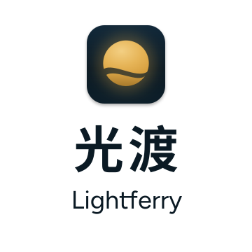
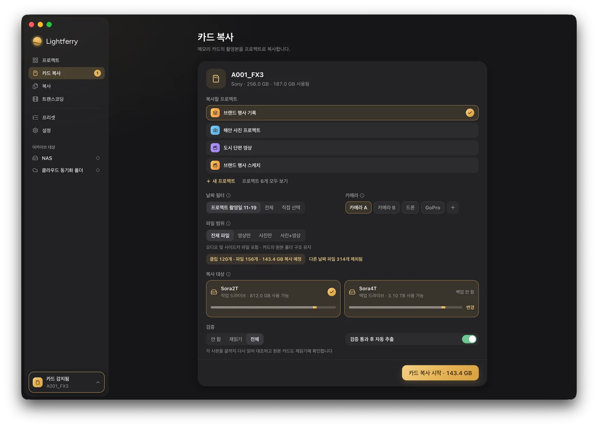
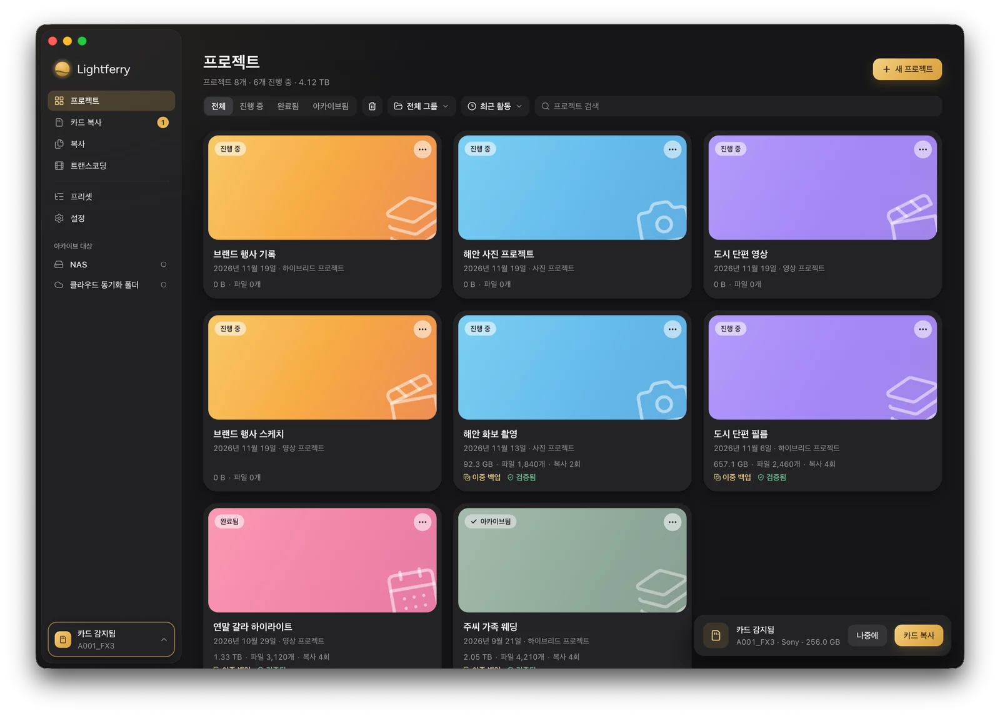
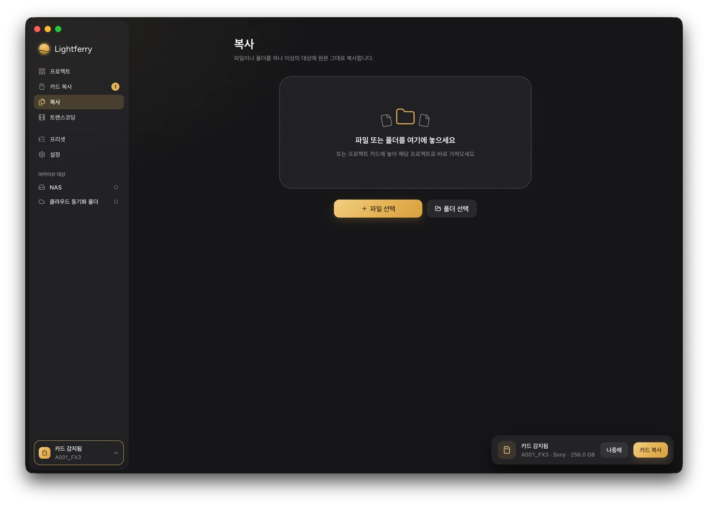

[简体中文](./README.md) · [繁體中文](./README.zh-TW.md) · [English](./README.en.md) · [日本語](./README.ja.md) · [한국어](./README.ko.md) · [Español](./README.es.md)

  <picture>
    <source media="(prefers-color-scheme: dark)" srcset="./brand/lockup-icon-white.svg">
    
  </picture>

<h3 align="center">모든 순간의 빛을, 안전하게 목적지까지.</h3>

사진가, DIT, 영상 제작 팀을 위한 Mac 촬영본 워크스페이스. 카메라 카드를 한 번만 읽어 작업 드라이브와 백업 드라이브에 동시에 기록하고, 사본마다 검증해 프로젝트별로 정리하며 나중에 찾아볼 수 있는 리포트를 남깁니다.

  
  
  

  <a href="https://github.com/Sorasukiawa/lightferry/releases/download/v1.0.0/Lightferry_1.0.0_aarch64.dmg"><strong>v1.0.0 다운로드 · Apple Silicon Mac</strong></a>
  &nbsp;·&nbsp; <a href="https://lightferry.app/ko/guides/">사용 가이드</a>
  &nbsp;·&nbsp; <a href="https://github.com/Sorasukiawa/lightferry/releases/tag/v1.0.0">업데이트 내용</a>
  &nbsp;·&nbsp; <a href="https://lightferry.app/ko/pricing/">구매</a>
  &nbsp;·&nbsp; <a href="./VERSIONS.md">전체 버전</a>

> [!NOTE]
> 설치 파일은 Apple Developer ID로 서명 및 공증되었습니다. [이 저장소의 Releases](https://github.com/Sorasukiawa/lightferry/releases) 또는 [lightferry.app](https://lightferry.app/ko/download/)에서 다운로드하세요.

Mac에서 촬영한 실제 앱 창 화면입니다. 카드를 꽂은 뒤 프로젝트와 카메라를 고르고 두 드라이브에 동시 기록 및 전체 검증을 진행합니다. 예시 프로젝트와 폴더는 데모용입니다.

## 복사 · 검증 · 정리

<table>
  <tr>
    <td valign="top" width="50%">
      <picture><source media="(prefers-color-scheme: dark)" srcset="./brand/icons/offload-dawn.svg"></picture> 
      <strong>카메라 카드 복사</strong> 
      카드를 꽂으면 사진, 영상, 오디오를 자동으로 인식해 프로젝트, 촬영일, 카메라별로 정리합니다. 원본 카드를 한 번만 읽어 작업 드라이브와 백업 드라이브에 동시에 기록합니다.
    </td>
    <td valign="top" width="50%">
      <picture><source media="(prefers-color-scheme: dark)" srcset="./brand/icons/copy-dawn.svg"></picture> 
      <strong>파일 및 폴더 복사</strong> 
      Finder에서 끌어다 놓거나 원본을 선택해 폴더 구조를 그대로 유지한 채 하나 이상의 대상에 복사합니다. 시작 전 여유 공간을 사전 점검합니다.
    </td>
  </tr>
  <tr>
    <td valign="top">
      <picture><source media="(prefers-color-scheme: dark)" srcset="./brand/icons/projects-dawn.svg"></picture> 
      <strong>편집 프로젝트 연동</strong> 
      새 프로젝트를 만들 때 Final Cut Pro, DaVinci Resolve, Premiere Pro, CapCut 중 하나를 고르면, 카드 복사 검증을 통과한 뒤 촬영본을 자동으로 보내거나 프로젝트를 생성합니다.
    </td>
    <td valign="top">
      <picture><source media="(prefers-color-scheme: dark)" srcset="./brand/icons/video-dawn.svg"></picture> 
      <strong>검토용 영상 및 프록시</strong> 
      영상을 H.264 검토용 클립이나 ProRes 편집 프록시로 변환하고 편집 프로그램에서 원본으로 재연결할 수 있습니다. Log 촬영본은 제조사 공식 LUT을 바로 받아 SHA-256을 확인한 뒤 Rec.709 검토용 클립으로 만들 수 있습니다.
    </td>
  </tr>
  <tr>
    <td valign="top">
      <picture><source media="(prefers-color-scheme: dark)" srcset="./brand/icons/organize-dawn.svg"></picture> 
      <strong>프로젝트 에셋 가져오기</strong> 
      기존 에셋을 지정한 프로젝트에 추가해 사진, 영상, 오디오, 편집 프로젝트 파일 등 카테고리별 폴더로 분류합니다.
    </td>
    <td valign="top">
      <picture><source media="(prefers-color-scheme: dark)" srcset="./brand/icons/archive-dawn.svg"></picture> 
      <strong>프로젝트 아카이브</strong> 
      프로젝트를 로컬 또는 네트워크 대상으로 아카이브하며 전체 검증을 필수로 수행합니다. 프로젝트 기록을 유지하고 로컬 촬영본을 자동으로 삭제하지 않습니다.
    </td>
  </tr>
  <tr>
    <td valign="top">
      <picture><source media="(prefers-color-scheme: dark)" srcset="./brand/icons/verify-dawn.svg"></picture> 
      <strong>3단계 검증</strong> 
      촬영본 중요도에 따라 검증 안 함, 빠른 검증, 전체 검증을 선택할 수 있으며, 대상마다 개별 검증 결과를 기록합니다.
    </td>
    <td valign="top">
      <picture><source media="(prefers-color-scheme: dark)" srcset="./brand/icons/recovery-dawn.svg"></picture> 
      <strong>중단 복구 및 재시도</strong> 
      작업 중단, 대상 연결 해제, 용량 부족 후에는 대상 식별 정보와 남은 공간을 다시 확인한 뒤 미완료 사본만 재시도합니다.
    </td>
  </tr>
  <tr>
    <td valign="top">
      <picture><source media="(prefers-color-scheme: dark)" srcset="./brand/icons/report-dawn.svg"></picture> 
      <strong>작업 리포트 및 이메일 알림</strong> 
      프로젝트, 날짜, 유형, 상태별로 결과를 찾아 오프라인 HTML, 다중 페이지 PDF, ASC MHL 매니페스트로 내보냅니다. 완료 이메일로 카드를 포맷해도 되는지 알려 주고, 완료 알림에서 해당 리포트를 바로 열 수 있습니다.
    </td>
    <td valign="top">
      <picture><source media="(prefers-color-scheme: dark)" srcset="./brand/icons/presets-dawn.svg"></picture> 
      <strong>폴더 프리셋</strong> 
      영상, 사진, 하이브리드 프로젝트용 기본 폴더 구조를 복제해 원하는 대로 수정할 수 있습니다. 새 프로젝트를 만들면 전체 폴더 트리가 자동 생성됩니다.
    </td>
  </tr>
</table>

## 세 가지 원칙

- **기존 파일을 덮어쓰지 않습니다.** 이름이 같은 파일이 있으면 건너뛸지 둘 다 유지할지 직접 선택하며, Lightferry가 임의로 교체하지 않습니다.
- **모든 사본에 개별 결과를 남깁니다.** 다중 대상 작업은 대상별로 복사와 검증 상태를 따로 기록합니다. 중단되거나 연결이 끊긴 뒤에도 대상 식별 정보와 용량을 재확인한 다음 미완료 사본만 보완합니다.
- **모든 처리는 Mac 안에서 로컬로 완료됩니다.** 촬영본 스캔, 복사, 검증, 프로젝트 기록은 기본적으로 이 Mac 안에서 수행되며, 사진이나 영상을 Lightferry 서버로 업로드하지 않습니다.

## Finder 드래그와 무엇이 다른가요?

| | Finder 드래그 | Lightferry |
| --- | --- | --- |
| 두 드라이브에 기록 | 두 번 끌어야 하고 카드도 두 번 읽음 | 한 번 읽어 동시에 기록 |
| 복사 후 확인 | 내용 검증 없음 | 사본별 빠른 검증 또는 전체 검증 |
| 연결 해제·중단 | 처음부터 다시 하거나 직접 대조 | 미완료 파일만 재시도 |
| 같은 이름의 파일 | 대치를 제안할 수 있음 | 기존 파일 절대 덮어쓰지 않음 |
| 폴더 정리 | 직접 생성 | 프로젝트·촬영일·카메라별 자동 정리 |
| 기록 보관 | 없음 | 작업 리포트(HTML / PDF 내보내기) |

## 카드 삽입부터 아카이브까지

1. **수집**: 카메라 카드를 꽂거나 파일·폴더를 끌어다 놓은 뒤 프로젝트와 카메라를 선택하고 촬영일로 필터링합니다.
2. **기록**: 여유 공간과 대상 식별 정보를 사전 점검한 뒤 원본을 한 번만 읽어 작업 드라이브와 백업 드라이브에 동시에 기록합니다.
3. **검증**: 빠른 검증은 각 사본을 다시 읽어 XXH64를 비교하고, 전체 검증은 원본 파일까지 독립적으로 다시 읽어 대조합니다.
4. **보관**: 작업 결과를 검색·내보내기할 수 있으며, 기록을 유지한 채 프로젝트를 로컬 또는 네트워크 대상으로 아카이브할 수 있습니다.

## 앱 화면 미리보기

### 프로젝트 워크스페이스

프로젝트마다 한 장의 카드로 유형, 촬영일, 용량, 파일 수를 보여 줍니다. 카드 복사가 끝나면 이중 백업 여부와 검증 통과 상태도 함께 표시됩니다. 진행 중, 완료, 아카이브됨, 휴지통 기준으로 필터링하거나 그룹으로 정리할 수 있습니다.

### 복사

파일과 폴더를 원본 계층 구조 그대로 하나 이상의 위치에 복사합니다. 시작 전에 대상별 남은 공간과 필요 공간을 확인하고, 복사가 끝나면 사본마다 검증합니다.

### 작업 리포트

카드 복사, 파일 복사, 에셋 가져오기, 아카이브가 끝나면 작업 리포트에서 프로젝트, 날짜, 유형, 상태별로 검색해 오프라인 HTML이나 다중 페이지 PDF로 내보낼 수 있습니다. 이전 기록에 누락된 필드는 성공으로 추정하지 않고 미기록으로 표시합니다.

모든 스크린샷은 Mac에서 촬영한 실제 앱 창 화면이며, 프로젝트·파일·경로는 데모용입니다.

## 검증 단계

- **검증 안 함**: 쓰기 과정의 오류 여부만 확인합니다. 임시 파일에는 쓸 수 있지만 중요한 촬영본에는 권장하지 않습니다.
- **빠른 검증**: 각 대상 파일을 다시 읽어 복사 중 계산한 원본 XXH64 해시와 대조합니다. 일상적인 카드 복사와 파일 복사에 적합합니다.
- **전체 검증**: 빠른 검증에 더해 모든 원본 파일을 독립적으로 다시 읽어 대조합니다. 중요한 촬영본, 이중 백업, 아카이브에 권장합니다.

XXH64는 내용 차이를 감지하는 체크섬이며 암호화 서명이 아닙니다. 검증을 통과한 뒤에도 핵심 촬영본은 직접 표본 확인하세요.

## 시작하기

1. 위에서 **Apple Silicon Mac**용 DMG를 다운로드하세요. Intel Mac과 Windows용 공개 설치 파일은 제공하지 않습니다. 칩 확인은 **Apple 메뉴 → 이 Mac에 관하여**에서 할 수 있습니다.
2. DMG를 열고 Lightferry를 '응용 프로그램'으로 드래그하세요. 처음 실행할 때 macOS가 인터넷에서 다운로드한 앱인지 확인하면 '열기'를 선택하면 됩니다.
3. 설정에서 작업 드라이브와 백업 드라이브를 지정하고 새 프로젝트를 만든 뒤 카드를 꽂으면 바로 시작할 수 있습니다. 중요한 촬영본은 원본 카드와 별도의 안전한 백업을 유지하고, 사본을 확인한 뒤에 카드를 포맷하세요.

- **칩**: Apple Silicon(M 시리즈)
- **운영체제**: macOS 13 이상
- **저장 장치**: 작업 드라이브, 백업 드라이브, 아카이브 대상은 APFS를 권장합니다. 안전 기능 점검을 통과한 ExFAT은 대상으로 사용할 수 있으며, ExFAT 카메라 카드는 읽기 전용 원본으로 사용할 수 있습니다.

카드 복사, 파일 복사 또는 아카이브 작업이 실행 중일 때는 업데이트 설치가 차단됩니다.

## 가격

Lightferry는 구독 없는 일회성 구매 방식입니다. 프로젝트 관리와 폴더 프리셋은 영구 무료이며, 각 작업 유형마다 3회 무료 체험 후 [lightferry.app](https://lightferry.app/ko/pricing/) 또는 앱 내에서 구매할 수 있습니다. Shiguang v0.2.2 및 이전 버전은 만료되지 않으며 계속 무료로 사용할 수 있습니다.

| 플랜 | 가격 | 포함 내용 |
| --- | --- | --- |
| 무료 버전 | $0 | 프로젝트, 작업 기록, 리포트, 프리셋은 언제나 사용 가능 · 카드 복사 및 파일 복사, 아카이브 등 작업 유형별 3회 무료(기한 제한 없음) |
| 영구 라이선스 | $59(출시 기념 기간 $49) | Mac 2대 동시 사용, 영구 사용 · 현재 메이저 버전 무료 업데이트 및 구매 후 1년 이내 출시되는 새 메이저 버전 무료 |
| 메이저 업그레이드 | $29 / 회 | 이후 새 메이저 버전으로 업그레이드 · 주문에 포함된 모든 Mac 적용 · 중간 버전을 건너뛰어도 동일 가격 · 자동 결제 없음 |
| 30일 패스 | $10 / Mac 1대 | 앱 내 구매 · 자동 갱신 없음 |
| 추가 Mac 슬롯 | $19 / 대 | 영구 라이선스 주문에 Mac 추가(라이선스당 기본 2대 포함 최대 4대) |

- 모든 유료 제품은 구매 후 14일 이내에 사유를 묻지 않고 전액 환불할 수 있습니다.
- 결제는 Creem에서 미국 달러(USD)로 처리합니다.
- 구매 시 부여된 권리는 추후 판매 정책이 변경되더라도 회수되지 않습니다.

## 자주 묻는 질문

<strong>Mac에서 앱을 열 수 없다고 나오면 어떻게 하나요?</strong>

Lightferry는 Apple 공증을 받았으므로 보통 처음 실행할 때 한 번만 확인하면 됩니다. 그래도 차단된다면 설치 파일을 이 저장소의 Releases 또는 lightferry.app에서 받았는지 확인한 뒤 **시스템 설정 → 개인정보 보호 및 보안**에서 안내를 확인하세요. [설치 도움말 보기](https://lightferry.app/ko/download/#download-help)

<strong>중간에 드라이브가 빠지거나 작업이 실패하면 처음부터 다시 복사해야 하나요?</strong>

아니요. 원본 카드, 기존 사본, 작업 기록을 그대로 두고 원래 장치를 다시 연결한 뒤 작업 복구 메뉴에서 상태를 확인하세요. 이미 완료된 파일을 확인하고 미완료 파일만 보완하므로 기존 사본을 먼저 삭제하지 마세요.

<strong>검증에 실패했는데 원본 카드를 포맷해도 되나요?</strong>

아직 포맷하지 마세요. 모든 대상 드라이브 결과를 확인하고 원본 카드와 정상 사본을 보관한 채 실패 기록을 바탕으로 원인을 점검해 재시도하세요. 진행률이 100%라고 해서 모든 사본이 검증을 통과한 것은 아닙니다. [완료 후 확인 사항 보기](https://lightferry.app/ko/guides/first-ingest/)

<strong>NAS로 바로 카드 복사할 수 있나요?</strong>

먼저 로컬 또는 외장 드라이브로 카드 복사를 마친 뒤, 프로젝트 상세 정보에서 NAS로 아카이브하세요. [NAS 아카이브 가이드 보기](https://lightferry.app/ko/guides/connect-nas/)

<strong>로컬 아카이브가 끝나면 클라우드 업로드도 완료된 것인가요?</strong>

아니요. Lightferry가 확인하는 범위는 로컬 복사와 검증까지입니다. 업로드 완료 여부는 클라우드 클라이언트와 웹에서 별도로 확인하세요. [클라우드 동기화 가이드 보기](https://lightferry.app/ko/guides/cloud-sync/)

<strong>Shiguang에서 업데이트할 때 알아 둘 점은 무엇인가요?</strong>

Shiguang 0.2.x에서 Lightferry 1.0으로 업데이트하면 유료 라이선스로 전환되며, 작업 유형마다 3회 무료 체험이 먼저 제공됩니다(이전 작업은 횟수에 포함되지 않음). 프로젝트, 그룹, 설정, 프리셋, 중단된 복사 기록은 자동으로 이전되고 기존 데이터 폴더는 그대로 보존됩니다(0.2.2를 다시 설치하면 이전 라이브러리를 열 수 있지만 1.0에서 변경한 내용은 반영되지 않습니다). 업데이트 후에도 '응용 프로그램' 폴더의 앱 이름은 'Shiguang'으로 남지만, Finder에서 'Lightferry'로 바꿔도 이후 앱 내 자동 업데이트에는 영향이 없습니다. 외장 드라이브와 네트워크 드라이브에 처음 접근할 때 macOS가 한 번 더 묻는데, '허용'을 선택하세요.

<strong>Intel Mac이나 Windows를 지원하나요? 가격은 얼마인가요?</strong>

현재 Apple Silicon Mac만 지원합니다. Lightferry는 일회성 구매 방식이며, 프로젝트 관리와 프리셋은 영구 무료, 각 작업은 3회 무료 체험이 제공됩니다. 영구 라이선스는 $59(출시 기념 기간 $49)입니다. 자세한 내용은 [가격](#가격)을 참고하세요.

## 현재 버전 · v1.0.0

- Shiguang이 Lightferry로 이름을 바꾸고 Apple Developer ID 서명과 공증을 완료했습니다.
- 편집 프로젝트 연동: 카드 복사 검증을 통과하면 Final Cut Pro, DaVinci Resolve, Premiere Pro, CapCut으로 자동 전송하거나 프로젝트를 생성합니다.
- 검토용 영상 및 편집 프록시: H.264 검토용 클립이나 ProRes 프록시를 만들어 원본으로 재연결하고, Log 촬영본은 제조사 공식 LUT으로 Rec.709 검토용 클립을 만들 수 있습니다.
- 한층 강화된 카드 검증: 캐시를 거치지 않는 전체 재읽기나 복사 중 검증을 선택할 수 있고, 완료 화면에서 포맷 가능 여부를 바로 알려 주며 ASC MHL도 내보낼 수 있습니다.
- 완료 이메일 알림과 웹 라이선스 관리: 카드를 포맷해도 되는지 이메일로 알려 주고, 웹사이트에서 라이선스를 관리하거나 복구할 수 있습니다.

[전체 릴리스 노트 읽기](https://github.com/Sorasukiawa/lightferry/releases/tag/v1.0.0) · [전체 버전 보기](./VERSIONS.md)

저장 드라이브 및 네트워크 폴더 안내

- 작업 드라이브, 백업 드라이브, 아카이브 대상은 APFS를 권장합니다. ExFAT은 Lightferry의 안전 기능 점검을 통과한 경우에만 대상으로 사용할 수 있으며, 안전성을 확인할 수 없으면 쓰기 전에 차단됩니다. ExFAT 카메라 카드는 읽기 전용 원본으로 사용할 수 있습니다. Lightferry는 기존 미디어의 포맷을 요구하지 않습니다.
- NAS나 서드파티 동기화 폴더를 아카이브 대상으로 선택한 경우 Lightferry는 로컬 복사와 검증까지만 확인합니다. 이후의 네트워크 전송이나 동기화는 운영체제와 해당 서비스가 처리하므로, 연결 해제 및 동기화 동작은 실제 사용 환경에서 확인하세요.

## 도움말 및 피드백

- **[사용 가이드](https://lightferry.app/ko/guides/)**: 설치, 카드 복사, 중단된 작업 복구, 아카이브를 단계별로 안내합니다.
- **[문제 제보 및 기능 제안](https://github.com/Sorasukiawa/lightferry/issues/new/choose)**: 양식에 따라 앱 버전, macOS 버전과 칩, 원본 및 대상 파일 시스템, 재현 단계, 오류 메시지를 남겨 주세요.
- **[질문 및 토론](https://github.com/Sorasukiawa/lightferry/discussions)**: 사용 질문, 워크플로, 아이디어를 공유할 수 있습니다.
- **비공개 문의**: [support@lightferry.app](mailto:support@lightferry.app)으로 메일을 보내 주세요. 보안 관련 제보는 [SECURITY.md](./SECURITY.md)를 참고하세요.

스크린샷에는 프로젝트 이름과 경로를 가려 주시고, **원본 촬영본이나 고객 자료는 절대 업로드하지 마세요.**

## 이 저장소 안내

> [!NOTE]
> 이 저장소는 설치 파일, 안내 문서, 릴리스 기록, 피드백을 위한 공간입니다. **Lightferry 앱의 소스 코드는 포함되어 있지 않으며 오픈소스 라이선스나 재배포 권한을 부여하지 않습니다.** 자세한 내용은 [LICENSE.md](./LICENSE.md)를 참고하세요. GitHub이 자동으로 생성하는 Source code 압축 파일은 이 저장소의 공개 문서만 담고 있으며 앱 설치 파일이 아닙니다.
