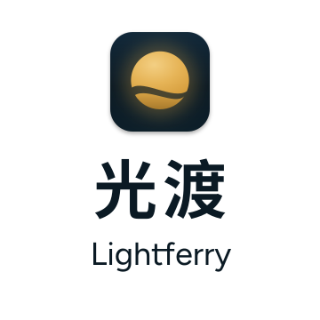
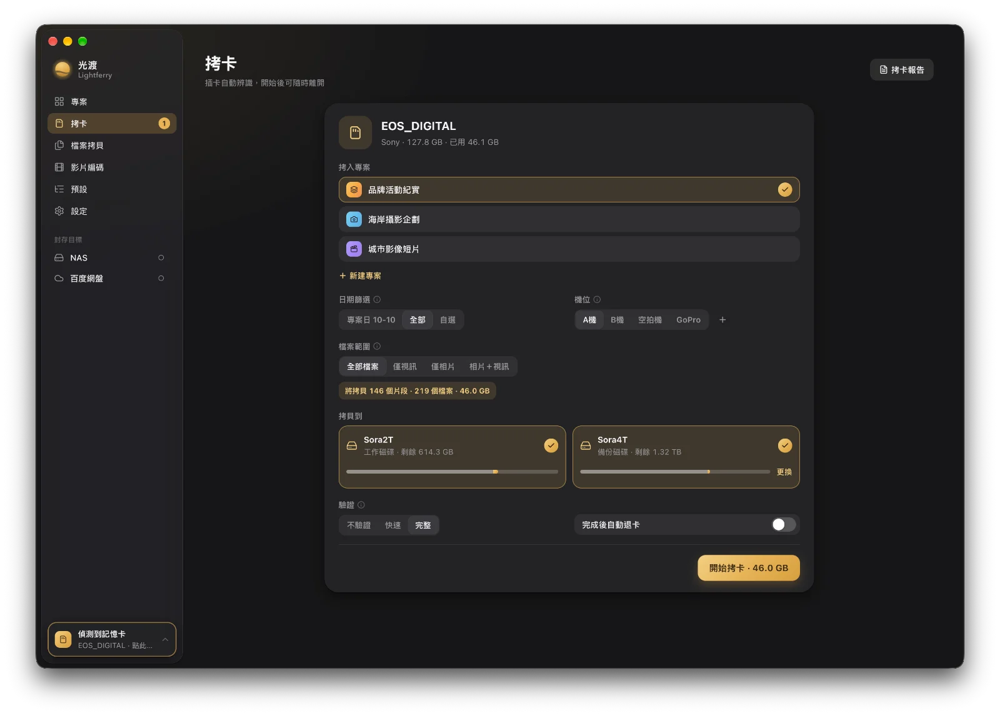
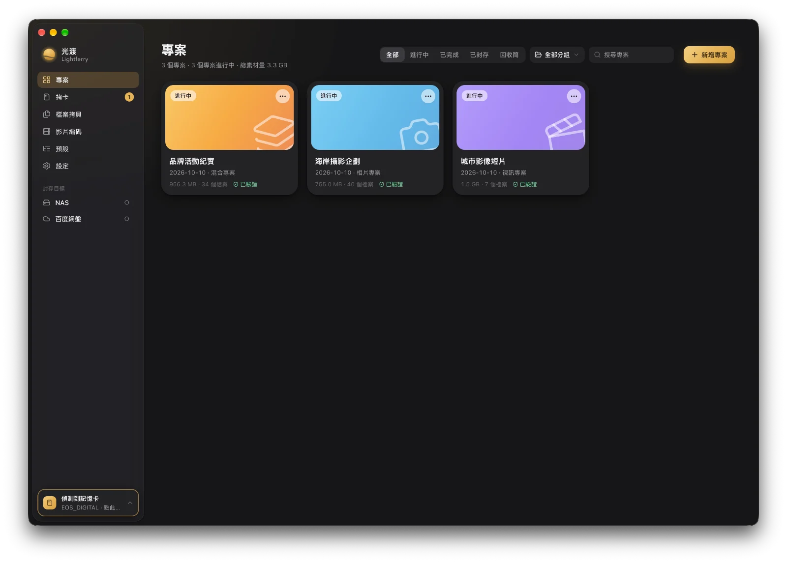
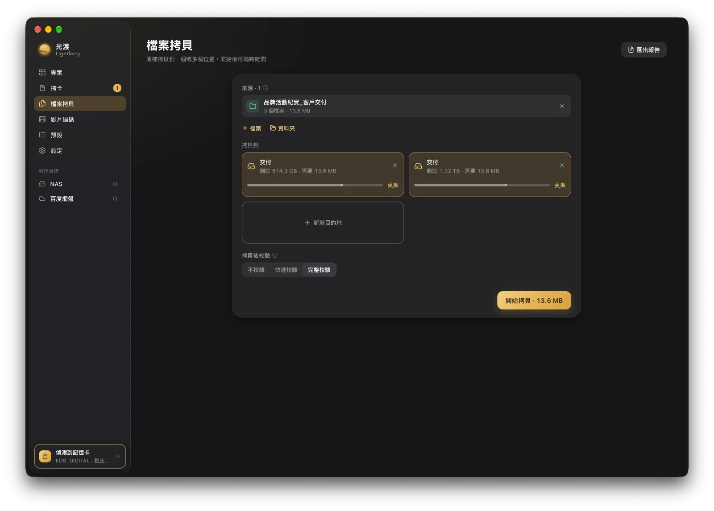

[简体中文](./README.md) · [繁體中文](./README.zh-TW.md) · [English](./README.en.md) · [日本語](./README.ja.md) · [한국어](./README.ko.md) · [Español](./README.es.md)

  <picture>
    <source media="(prefers-color-scheme: dark)" srcset="./brand/lockup-icon-white.svg">
    
  </picture>

<h3 align="center">讓每一束光，安然抵達。</h3>

為攝影師、DIT 與影像製作團隊設計的 Mac 素材工作台。 讀一次記憶卡，同時寫入工作碟與備份碟；逐份驗證，依專案歸位，留下可查的報告。

  
  
  

  <a href="https://github.com/Sorasukiawa/lightferry/releases/download/v1.0.1/Lightferry_1.0.1_aarch64.dmg"><strong>下載 v1.0.1 · Apple Silicon Mac</strong></a>
  &nbsp;·&nbsp; <a href="https://lightferry.app/zh-tw/guides/">使用指南</a>
  &nbsp;·&nbsp; <a href="https://github.com/Sorasukiawa/lightferry/releases/tag/v1.0.1">本次更新</a>
  &nbsp;·&nbsp; <a href="https://lightferry.app/zh-tw/pricing/">購買</a>
  &nbsp;·&nbsp; <a href="./VERSIONS.md">全部版本</a>

> [!NOTE]
> 安裝包已通過 Apple Developer ID 簽名與公證。請從[本倉庫 Releases](https://github.com/Sorasukiawa/lightferry/releases) 或 [lightferry.app](https://lightferry.app/zh-tw/download/) 下載。

Mac 上的實際視窗截圖：插卡後選好專案與機位，同時寫入兩顆硬碟並完整驗證。示例專案與資料夾為演示用。

## 拷貝 · 驗證 · 整理

<table>
  <tr>
    <td valign="top" width="50%">
      <picture><source media="(prefers-color-scheme: dark)" srcset="./brand/icons/offload-dawn.svg"></picture> 
      <strong>記憶卡拷卡</strong> 
      插卡自動辨識照片、影片與音訊，依專案、拍攝日與機位歸位。讀取來源一次，同時寫入工作碟與第二備份碟。
    </td>
    <td valign="top" width="50%">
      <picture><source media="(prefers-color-scheme: dark)" srcset="./brand/icons/copy-dawn.svg"></picture> 
      <strong>檔案與資料夾拷貝</strong> 
      從 Finder 拖入或選擇來源，保留資料夾層級，原樣寫入一個或多個目的地；開始前預檢空間。
    </td>
  </tr>
  <tr>
    <td valign="top">
      <picture><source media="(prefers-color-scheme: dark)" srcset="./brand/icons/projects-dawn.svg"></picture> 
      <strong>剪輯專案銜接</strong> 
      新建專案可選 Final Cut Pro、DaVinci Resolve、Premiere Pro 或 CapCut，拷卡驗證通過後自動送入或產生專案。
    </td>
    <td valign="top">
      <picture><source media="(prefers-color-scheme: dark)" srcset="./brand/icons/video-dawn.svg"></picture> 
      <strong>影片審片與代理</strong> 
      把影片轉成 H.264 審片小樣或 ProRes 剪輯代理，可在剪輯軟體裡連回原片；Log 素材可直連廠商官方 LUT 並核對 SHA-256，轉成 Rec.709 審片小樣。
    </td>
  </tr>
  <tr>
    <td valign="top">
      <picture><source media="(prefers-color-scheme: dark)" srcset="./brand/icons/organize-dawn.svg"></picture> 
      <strong>專案素材匯入</strong> 
      把現有素材加入指定專案，依照片、影片、音訊、工程檔等類別放進專案資料夾。
    </td>
    <td valign="top">
      <picture><source media="(prefers-color-scheme: dark)" srcset="./brand/icons/archive-dawn.svg"></picture> 
      <strong>專案封存</strong> 
      把專案封存到本機或網路目的地，封存前強制完整驗證；保留原專案紀錄，不會自動刪除本機素材。
    </td>
  </tr>
  <tr>
    <td valign="top">
      <picture><source media="(prefers-color-scheme: dark)" srcset="./brand/icons/verify-dawn.svg"></picture> 
      <strong>三檔驗證</strong> 
      不驗證、快速驗證、完整驗證依素材重要程度選擇；每個目的地分別給出驗證結果。
    </td>
    <td valign="top">
      <picture><source media="(prefers-color-scheme: dark)" srcset="./brand/icons/recovery-dawn.svg"></picture> 
      <strong>中斷復原與補拷</strong> 
      中斷、目的地離線或磁碟寫滿後，先重新確認目的地身分與空間，再只補未完成的副本，不重寫已完成的檔案。
    </td>
  </tr>
  <tr>
    <td valign="top">
      <picture><source media="(prefers-color-scheme: dark)" srcset="./brand/icons/report-dawn.svg"></picture> 
      <strong>工作報告與郵件通知</strong> 
      依專案、日期、類型與狀態搜尋工作結果，匯出離線 HTML、多頁 PDF 與 ASC MHL 清單；拷完可寄信告知記憶卡能不能格式化，完成通知可直接開啟對應報告。
    </td>
    <td valign="top">
      <picture><source media="(prefers-color-scheme: dark)" srcset="./brand/icons/presets-dawn.svg"></picture> 
      <strong>資料夾預設</strong> 
      內建影片、相片與混合專案的目錄結構，可複製後自訂；新建專案時自動產生整套資料夾。
    </td>
  </tr>
</table>

## 三條底線

- **不覆蓋現有檔案。** 遇到同名內容由你決定跳過或兩份都保留，光渡不會靜默取代。
- **每一份副本都有自己的結果。** 多目的地工作分別記錄拷貝與驗證狀態；中斷或目的地離線後，先重新確認目的地身分與空間，再補齊未完成的副本。
- **一切在本機完成。** 素材掃描、複製、驗證與專案紀錄預設在本機完成，不會上傳到光渡伺服器。

## 為什麼不直接用 Finder 拖？

| | Finder 拖曳 | 光渡 |
| --- | --- | --- |
| 寫入兩顆硬碟 | 分兩次拖，卡要讀兩遍 | 讀一次卡，同時寫入 |
| 拷完核對 | 不核對內容 | 快速或完整驗證，逐份給出結果 |
| 拔碟或中斷 | 從頭再來，或自己比對 | 只補未完成的檔案 |
| 同名檔案 | 可能提示取代 | 絕不覆蓋現有檔案 |
| 資料夾 | 手動新建 | 依專案、拍攝日與機位自動歸位 |
| 留檔 | 沒有紀錄 | 工作報告，可匯出 HTML 或 PDF |

## 從插卡到封存

1. **收取**：插入記憶卡，或拖入檔案與資料夾；選擇專案與機位，依拍攝日篩選。
2. **落盤**：讀取來源一次，同時寫入工作碟與備份碟；開始前先預檢空間與目的地身分。
3. **驗證**：快速驗證回讀每份副本比對 XXH64；完整驗證再獨立重讀來源。
4. **留檔**：工作結果可搜尋、匯出；專案可封存到本機或網路目的地，並保留紀錄。

## 看看介面

### 專案工作台

每個專案一張卡片，顯示類型、拍攝日、素材量與檔案數；拷卡完成後還會標出是否雙備份、是否通過驗證。可依進行中、已完成、已封存與回收站篩選，也可以分組。

### 拷貝

檔案與資料夾原樣拷到一個或多個位置，保留資料夾層級；開始前顯示每個目的地的剩餘空間與所需空間，拷完逐份驗證。

### 工作報告

拷卡、檔案拷貝、素材匯入與封存完成後，都能在工作報告裡依專案、日期、類型與狀態搜尋，並匯出離線 HTML 或多頁 PDF。舊紀錄缺少的欄位會標為「未記錄」，不會推定成功。

以上均為 Mac 上的實際視窗截圖；專案、檔案與路徑為演示用。

## 驗證方式

- **不驗證**：只依據寫入過程是否報錯。適合暫存檔案，不適合重要素材。
- **快速驗證**：重讀每份目的地檔案，以 XXH64 比對寫入時的來源雜湊。適合日常拷卡與檔案拷貝。
- **完整驗證**：在快速驗證之上，再獨立重讀所有來源檔案。適合重要素材、雙備份與封存。

XXH64 是內容差異檢查，不是加密簽名；通過後仍應人工抽查關鍵素材。

## 開始使用

1. 下載上方的 **Apple Silicon Mac** DMG；目前沒有 Intel Mac 或 Windows 公開安裝包。可在 ** → 關於這台 Mac** 查看晶片。
2. 開啟 DMG，把光渡拖進「應用程式」。首次開啟時 macOS 會確認這是從網際網路下載的 App，選擇「打開」即可。
3. 在設定裡選好工作碟與備份碟，新建專案，插卡即可開始。重要素材請保留原卡和另一份可靠備份，確認副本後才格式化記憶卡。

- **晶片**：Apple Silicon（M 系列）
- **系統**：macOS 13 以上
- **儲存**：工作碟、備份碟與封存目的地建議 APFS；通過安全能力檢查的 ExFAT 可作目的地，ExFAT 記憶卡可作唯讀來源

拷卡、檔案拷貝或封存執行時會阻止安裝更新。

## 價格

光渡採用買斷制，沒有訂閱。專案管理與資料夾預設永久免費，每類工作可以先免費試用 3 次，滿意再買；在 [lightferry.app](https://lightferry.app/zh-tw/pricing/) 或 App 內購買。拾光 v0.2.2 及更早版本不會到期，可繼續免費使用。

| 方案 | 價格 | 包含 |
| --- | --- | --- |
| 免費版 | $0 | 專案、歷史紀錄、報告與預設始終可用；拷卡與拷貝、封存等每類工作各可免費使用 3 次，不限天數 |
| 永久版 | $59，首發期 $49 | 2 台 Mac 同時使用，永久使用；目前大版本永久免費更新，購買後一年內發布的新大版本也免費 |
| 大版本升級 | $29 / 次 | 升級到之後的新大版本，涵蓋訂單內所有 Mac，跳版本同價，不自動扣款 |
| 30 天短期卡 | $10 / 台 | 在 App 內購買，不自動續費 |
| 增購名額 | $19 / 台 | 為永久版訂單增加 Mac（每份授權含原有 2 台最多共 4 台） |

- 所有付費產品購買後 14 天內可全額退款，不問原因。
- 由 Creem 以美元收款；可透過銀行卡、Apple Pay、Google Pay 或支付寶付款。
- 購買時取得的權益，不會因日後的銷售政策調整而收回。

## 常見問題

<strong>Mac 提示無法開啟怎麼辦？</strong>

光渡已通過 Apple 公證，正常情況下首次開啟只需確認一次。如果仍被阻止，請確認安裝包來自本倉庫 Releases 或 lightferry.app，再到「系統設定 → 隱私權與安全性」查看提示。[查看安裝協助](https://lightferry.app/zh-tw/download/#download-help)

<strong>中途拔碟或工作失敗，需要全部重拷嗎？</strong>

不需要。先保留原卡、現有副本與工作紀錄，重新連接原裝置，再由工作恢復入口檢查。恢復會檢查已完成檔案並補齊未完成部分；不要先刪除現有副本。

<strong>驗證未通過，可以格式化原卡嗎？</strong>

先不要格式化。檢查每個目標碟的結果，保留原卡與正確副本，依失敗紀錄排查並重試。進度 100% 不代表所有副本都已通過驗證。[瞭解完成後的檢查](https://lightferry.app/zh-tw/guides/first-ingest/)

<strong>可以直接拷到 NAS 嗎？</strong>

拷卡需先寫入本機或外接磁碟，再從專案詳情封存至 NAS。[查看 NAS 封存指南](https://lightferry.app/zh-tw/guides/connect-nas/)

<strong>本機封存完成，就是網盤上傳成功嗎？</strong>

不是。光渡確認的是本機拷貝與驗證，請在網盤用戶端與雲端另外確認上傳結果。[查看網盤同步指南](https://lightferry.app/zh-tw/guides/cloud-sync/)

<strong>從拾光升級需要注意什麼？</strong>

從拾光 0.2.x 升級到光渡 1.0 後改為收費模式，每類工作先有 3 次免費試用（歷史工作不扣次）。專案、分組、設定、預設與中斷拷貝紀錄會自動遷移，舊資料目錄原樣保留（回裝 0.2.2 仍可讀取舊資料庫，但 1.0 的新改動不會反向同步）。升級後「應用程式」裡的外層包名仍叫「拾光」，可以直接在 Finder 裡改名為「光渡」，不影響後續 App 內自動更新。第一次存取外接磁碟和網路磁碟時 macOS 會再詢問一次，請選擇「允許」。

<strong>支援 Intel Mac、Windows 嗎？收費嗎？</strong>

目前僅支援 Apple 晶片 Mac。光渡採用買斷制：專案管理與資料夾預設永久免費，每類工作可免費試用 3 次，永久版 $59（首發期 $49），詳見[價格](#價格)。

## 目前版本 · v1.0.1

v1.0.1 為修正版：設定與預設不再因檔案損毀而遺失，插回拷過的卡可以直接補做記憶卡複核，外語介面與匯出報告不再夾雜簡體中文。1.0 的主要內容：

- 拾光更名為光渡，安裝包通過 Apple Developer ID 簽名與公證。
- 剪輯專案銜接：拷卡驗證通過後自動送入或產生 Final Cut Pro、DaVinci Resolve、Premiere Pro 或 CapCut 專案。
- 影片審片與剪輯代理：轉出 H.264 審片小樣或 ProRes 代理並連回原片；Log 素材可直連廠商官方 LUT 轉成 Rec.709 審片小樣。
- 更嚴格的拷卡驗證：可選略過快取完整回讀或邊拷邊驗，完成頁直接給出能否格式化的結論，並可匯出 ASC MHL 清單。
- 拷完郵件通知與網頁授權管理：工作結束後寄信告知記憶卡能不能格式化，可在官網管理與找回授權。

[完整版本說明](https://github.com/Sorasukiawa/lightferry/releases/tag/v1.0.1) · [所有版本](./VERSIONS.md)

儲存裝置與網路資料夾

- 工作碟、第二備份碟及封存目的地建議使用 APFS。ExFAT 可作為目的地，但必須先通過光渡的安全能力檢查；無法確認安全時會在寫入前拒絕。ExFAT 記憶卡可作為唯讀來源。光渡不要求格式化現有媒體。
- 若選擇 NAS 或第三方同步資料夾作為封存目的地，光渡只確認本機複製與驗證；後續網路傳輸或同步由相應系統與服務處理，斷線與同步行為應依實際環境確認。

## 幫助與回饋

- **[使用指南](https://lightferry.app/zh-tw/guides/)**：安裝、拷卡、恢復中斷工作與封存的圖文步驟。
- **[回報問題或建議](https://github.com/Sorasukiawa/lightferry/issues/new/choose)**：依表單填寫版本、macOS 與晶片型號、來源及目的地格式、重現步驟和錯誤文字。
- **[提問與交流](https://github.com/Sorasukiawa/lightferry/discussions)**：使用問題、工作流程與想法。
- **不便公開的問題**：寄信到 [support@lightferry.app](mailto:support@lightferry.app)；安全問題請看 [SECURITY.md](./SECURITY.md)。

截圖請遮蔽專案名稱與路徑，**不要上傳原始素材或客戶資料**。

## 關於本倉庫

> [!NOTE]
> 本倉庫用於發佈安裝包、說明、版本紀錄與回饋。**不包含光渡 App 原始碼，沒有提供開源授權或再散佈權利**，詳見 [LICENSE.md](./LICENSE.md)。GitHub 自動產生的 Source code 壓縮檔只是本倉庫的公開資料，不能用來安裝光渡。
